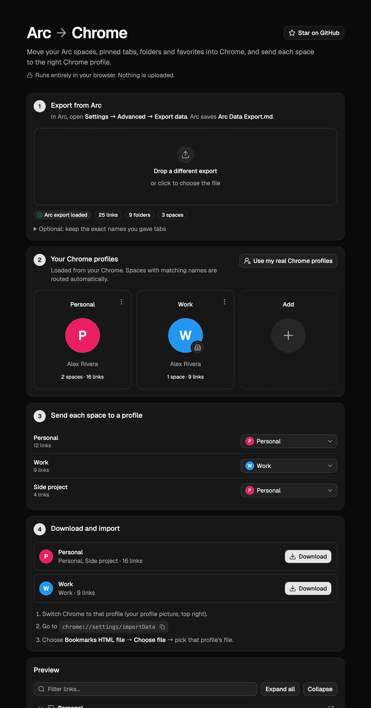

<div align="center">

# Arc → Chrome

**Move your Arc spaces into Chrome, and send each space to the right Chrome profile.**

[**Open the tool →**](https://arc-to-chrome.vercel.app) &nbsp;·&nbsp; `npx arc-to-chrome`

Free, open source, and private: it runs in your browser and nothing is uploaded.



</div>

## Why

Arc is no longer being actively developed, and plenty of us are heading back to Chrome. Chrome
can't import from Arc, and Arc's own export is a Markdown file that Chrome doesn't understand.
If you organised your life into spaces (Personal, Work, a side project), you also don't want them
all dumped into one profile.

This tool turns your Arc data into bookmark files Chrome can import, **one per Chrome profile**, with
your folders, nesting and Favorites intact.

## Use it in 3 steps

1. In Arc, open **Settings → Advanced → Export data**. Arc saves `Arc Data Export.md`.
2. Drop it on **[arc-to-chrome.vercel.app](https://arc-to-chrome.vercel.app)**. Click **Use my real
   Chrome profiles**, copy the one-line command, run it in Terminal and press ⌘V back on the page.
   Your actual profiles appear (names, colours, work badges), and spaces with matching names are
   routed automatically. The command only reads Chrome's profile list, using tools built into macOS
   and Windows.
3. Download each file and, in that Chrome profile, open `chrome://settings/importData` and choose
   **Bookmarks HTML file**.

Want to see it first? The site has a **Try it with sample data** button.

## What carries over

| In Arc | In Chrome |
| --- | --- |
| Spaces | Sent to the Chrome profile you pick. The first space lands flat on the bookmarks bar; extra spaces become folders |
| Favorites | Bookmarks right on the bar |
| Pinned tabs and folders | Bookmarks and folders, with the same nesting |
| Live folders (e.g. GitHub PRs) | Left out by default, since Arc refills them itself (tick them in the preview to keep a snapshot) |
| Renamed tabs | Your custom names, if you also drop `StorableSidebar.json` (see below) |
| Extensions | A folder of Chrome Web Store links to reinstall them (command line only) |

Arc's Markdown export only contains URLs, so bookmarks get readable names generated from each link
(`Google Sheet · 1BxiMV`, `next.js PR #1482`, `news.ycombinator.com › submit`).

**Keep your exact tab names:** also drop `StorableSidebar.json`. In Finder press `⌘ ⇧ G`, paste
`~/Library/Application Support/Arc/`, and use that file (not the dated backups next to it).

**Passwords:** export them from `arc://settings/passwords` as CSV, import that file at
`chrome://password-manager/settings`, then delete the CSV.

Not carried over: history, Boosts, Easels and Notes.

**Why an "Imported" folder?** Chrome puts imports straight onto the bookmarks bar only when the bar is
empty. If it already has bookmarks, Chrome wraps the import in one "Imported" folder; you can drag
the contents out.

## Command line

Prefer the terminal? The CLI reads Arc's data directly (macOS and Windows) and matches spaces to
your real Chrome profiles by name:

```console
$ npx arc-to-chrome --open

Arc space            →  Chrome profile
  Personal (36)        →  Personal
  Work (21)            →  Work
  Side project (4)     →  Personal
  Random (0)           →  skipped
```

| Option | |
| --- | --- |
| `--map "<space>=<profile>"` | Send a space to a specific Chrome profile, or `=skip` (repeatable) |
| `--open` | Open Chrome's import page in each target profile (macOS) |
| `--markdown <file>` | Use Arc's `Arc Data Export.md` instead of reading Arc's files |
| `--arc-dir <path>` | Folder with `StorableSidebar.json`, if auto-detect fails |
| `--out <dir>` | Output folder (default `./arc-export`) |
| `--no-unpinned` | Skip open, unpinned ("Today") tabs |
| `--no-extensions` | Skip the extensions folder |
| `--include-live` | Keep live folders such as GitHub pull requests |

## Privacy

The web page is static HTML and JavaScript. Your file is read in the browser and turned into a
download on the spot. The site's Content Security Policy blocks requests to any other server, so
it couldn't send your data anywhere even if it tried. The command line works fully offline.

## Development

```sh
npm install
npm run dev       # web app (Vite + React + Tailwind + shadcn/ui)
npm test          # conversion tests, node --test
```

`src/convert.js` holds all the conversion logic as plain JavaScript and is shared by the web app
(`app/`) and the zero-dependency CLI (`bin/arc-to-chrome.js`). Issues and PRs are welcome, especially for Windows paths and
Arc item types that aren't handled yet.

If this saved you an evening of copying links, a ⭐ helps other Arc users find it.

## License

MIT
